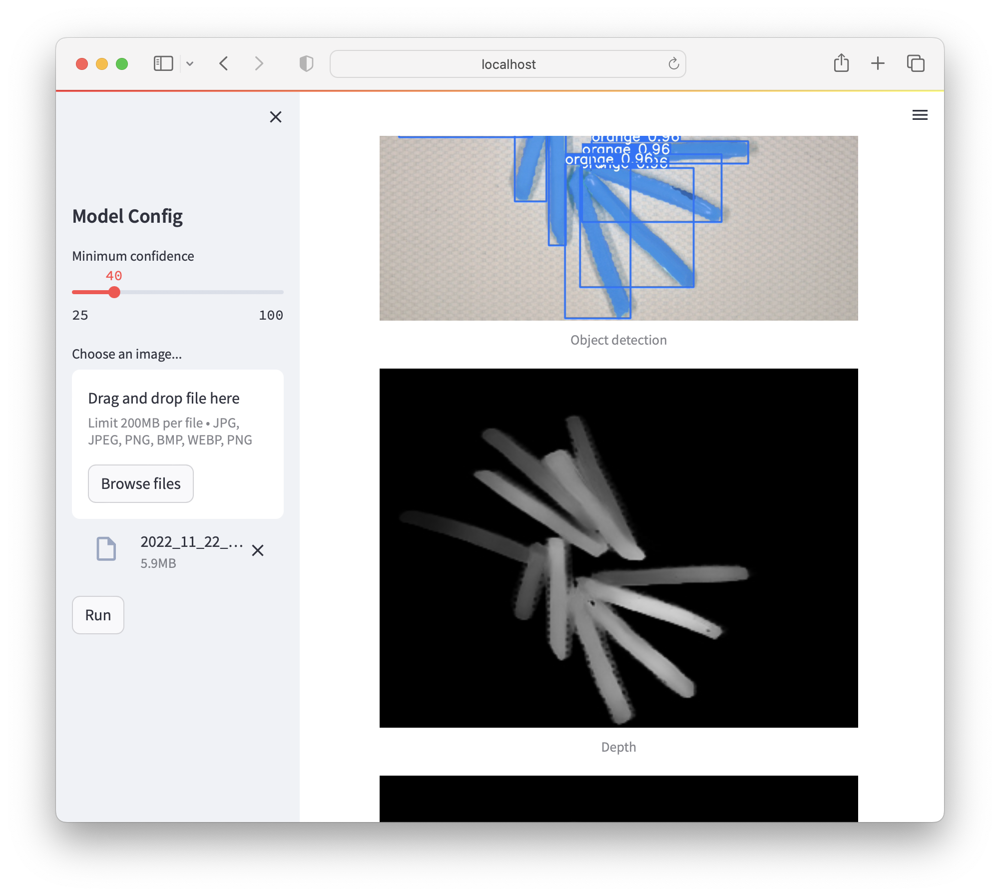

# potato_detection

Instance segmentation and relative depth for fried potatoes on a plate, trained only on synthetic images built from real photos. An experiment from 2023, kept as a record; it is not maintained.



## Approach

1. **Cut out single potatoes.** Otsu thresholding on the Cr channel separates potatoes from the plate; for defect classes, subtracting a background shot works better. Connected components give one patch per potato, and patches outside the 10th–80th area percentile are dropped, which removes potatoes merged by the threshold.
2. **Synthesize a training set.** 10,000 images, each a background with about 40 patches placed near the center, randomly rotated. Paste order gives the depth order, so every image comes with instance masks, YOLO labels and a depth map for free. Patches less than 25% visible after overlap are dropped from the labels.
3. **Detect and segment** with YOLOv8m-seg over four classes: `light`, `light_defect`, `orange`, `orange_defect`.
4. **Estimate depth** with a U-Net on a DenseNet169 encoder, then turn it into a relative order per plate: mean depth per detected instance, ranked inside each pile of touching potatoes.
5. **Demo**: a Streamlit app that shows the detections, the depth map and the instances shaded by depth.

## Results

YOLOv8m-seg after 25 epochs (about 3 hours on one T4), on the synthetic validation split:

| | Precision | Recall | mAP50 | mAP50-95 |
|---|---|---|---|---|
| Box | 0.932 | 0.868 | 0.950 | 0.837 |
| Mask | 0.936 | 0.876 | 0.934 | 0.689 |

The depth model trained for 10 epochs (about 5 hours on one T4); its curves are in `docs/depth/`.

On real photos the main errors are shadows detected as potatoes, often as a defect class because they are dark, and heavily occluded potatoes in tall piles. [main.ipynb](main.ipynb) walks through every step with figures and these failure cases.

## Layout

| File | |
|---|---|
| `config.py` | data path, classes, synthesis and training parameters |
| `data.py` | patch extraction, image synthesis, export to YOLO and depth lists |
| `dense_unet.py` | depth model, adapted from [bmanikan's gists](https://gist.github.com/bmanikan/1cf05d6cc8a02d07ae66da7bdd003c9e) |
| `mono.py`, `mono_train.py` | depth training and per-instance relative depth |
| `model_complex.py` | YOLO and depth model together |
| `app.py`, `Dockerfile` | Streamlit demo on port 5555, CUDA 11.8 image |
| `main.ipynb` | the full report |

## Running it

```sh
pip install -r requirements.txt   # Python 3.8, as in the Dockerfile
python data.py                    # synthesize the training set from data/fried_potato
python mono_train.py              # train the depth model
streamlit run app.py              # needs weights/yolo.pt and weights/cp.ckpt
```

The YOLO model is trained from the notebook. The photos and trained weights are not in the repository: `data.py` expects `data/fried_potato/{background,light,light_defect,orange,orange_defect}/*.png`. Synthesizing 10,000 images takes about 30 minutes on 16 processes and 60 GB of disk.

## License

[Apache-2.0](LICENSE), except `dense_unet.py`, which is adapted from bmanikan's gists and keeps their terms.
